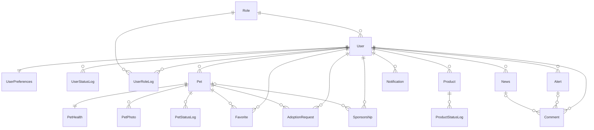
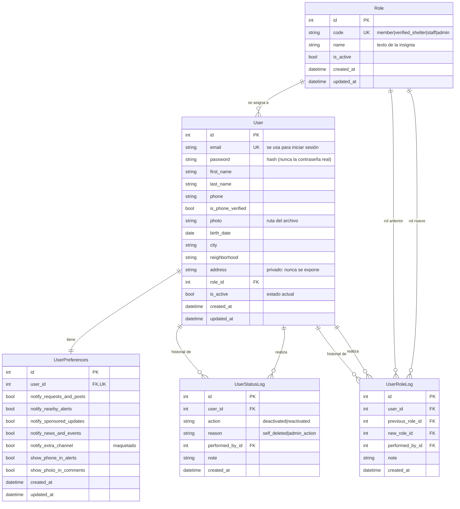
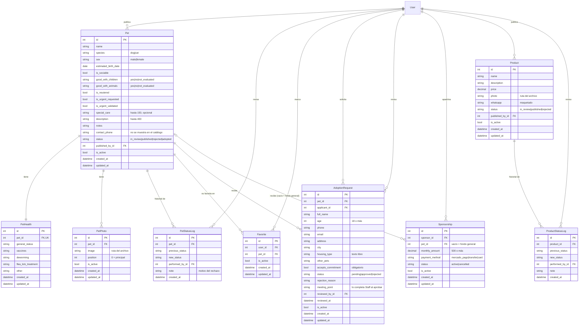
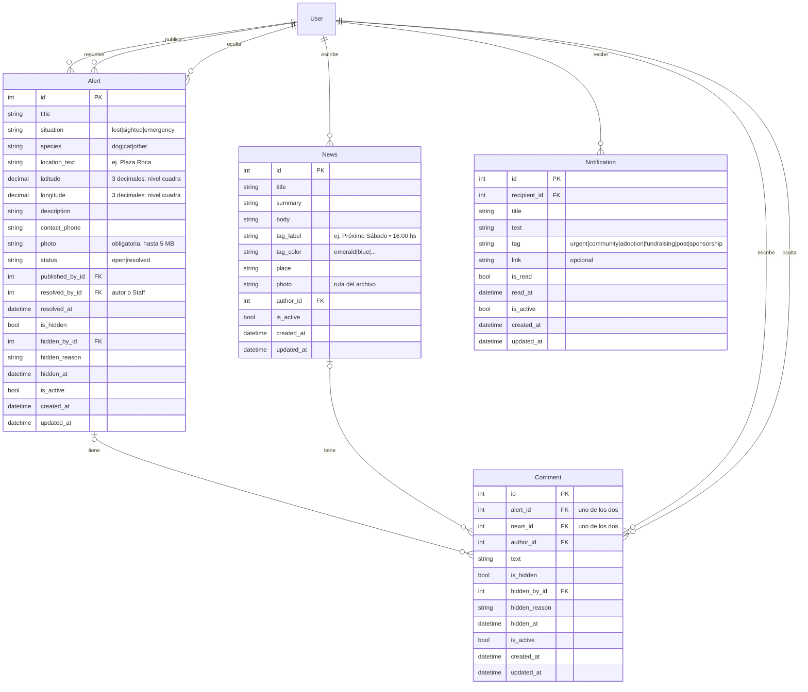

# Callejeros Río Cuarto

Plataforma web comunitaria de **adopción responsable** y **alertas de animales en la calle** para Río Cuarto (Córdoba, Argentina). Conecta a refugios, particulares y vecinos: catálogo de mascotas en adopción, Alerta Callejeros para animales perdidos o en peligro, apadrinamiento, tienda solidaria y noticias.

Proyecto integrador de la **Práctica Profesionalizante II** — Tecnicatura Superior en Desarrollo de Software, ITEC, 2026.

> 🚧 **En desarrollo · versión actual: v0.1** ([qué trae cada versión](#versiones)). Este README se completa a medida que avanza el proyecto (arquitectura, base de datos, instalación, variables de entorno, tests y API).

## Equipo

| Integrante | GitHub |
| :--- | :--- |
| Franco Nicolás Bressan Nadal | [@fbressan-itec](https://github.com/fbressan-itec) |
| Ulises Cabrera | [@Ulicrack](https://github.com/Ulicrack) |
| Leandro Odetto | [@leandroitec](https://github.com/leandroitec) |

## Tecnologías

| Parte | Tecnologías |
| :--- | :--- |
| Backend | Python · Django · Django REST Framework · SimpleJWT · django-filter · drf-spectacular (Swagger) · uv · pytest · ruff |
| Base de datos | ORM de Django · SQLite |
| Frontend | Next.js · React · TypeScript · Tailwind CSS 4 · Vitest · ESLint · Prettier |
| DevOps | Docker · GitHub Actions |
| Organización | GitHub Projects (Kanban) |

## Estructura

```
backend/    API REST (Django + DRF)
frontend/   Aplicación web (Next.js)
docs/       Documentación y bitácora del equipo
```

## Cómo correr el proyecto en local

Hay dos formas: **con Docker** (levanta todo, o el back o el front por separado, sin instalar Python ni Node) o **sin Docker** (cada parte con sus herramientas). Las dos usan el mismo `.env`.

### 1. Preparar (una sola vez)

1. Cloná el repo y entrá a la carpeta:
   ```bash
   git clone https://github.com/fbressan-itec/callejeros_app.git
   cd callejeros_app
   ```
2. Creá tu `.env` a partir del ejemplo (en la raíz del repo):
   ```bash
   cp .env.example .env
   ```
   En PowerShell: `Copy-Item .env.example .env`.
3. Generá una clave secreta y pegala en `DJANGO_SECRET_KEY` de tu `.env`. Con uv (desde `backend/`):
   ```bash
   uv run python -c "from django.core.management.utils import get_random_secret_key as k; print(k())"
   ```
   O con Docker (desde la raíz):
   ```bash
   docker compose run --rm backend uv run python -c "from django.core.management.utils import get_random_secret_key as k; print(k())"
   ```

### 2a. Con Docker

**Requisito:** [Docker Desktop](https://www.docker.com/products/docker-desktop/) abierto ("Engine running"). Los comandos se corren desde la raíz del repo.

| Qué levantar | Comando | Dirección |
| :--- | :--- | :--- |
| Todo el proyecto | `docker compose up --build --watch` | back en <http://localhost:8000> y front en <http://localhost:3000> |
| Solo el back | `docker compose up --build backend` | <http://localhost:8000> |
| Solo el front | `docker compose up --build --watch frontend` | <http://localhost:3000> |

- **Apagar:** `Ctrl+C` en la misma terminal, o `docker compose down`.
- **Cambios en el código:** se ven al instante, sin volver a armar la imagen. En el front, gracias a `--watch`: Docker copia al contenedor cada archivo que guardás (sin `--watch`, el front no se entera de los cambios). Si agregás una dependencia, volvé a correr el comando con `--build`.
- **Correr un comando dentro de un contenedor:** `docker compose run --rm <servicio> <comando>`, por ejemplo `docker compose run --rm backend uv run pytest` o `docker compose run --rm frontend npm test`.
- **Para programar el front, conviene sin Docker** (`npm run dev`, abajo): en Windows, Next recarga más rápido así. Docker es ideal para levantar todo sin instalar Python ni Node.

Cada parte tiene su propio `Dockerfile` (`backend/Dockerfile` y `frontend/Dockerfile`); el `docker-compose.yml` de la raíz los levanta juntos o por separado.

### 2b. Sin Docker

#### Backend

**Requisito:** [uv](https://docs.astral.sh/uv/getting-started/installation/). No hace falta instalar Python: uv descarga la versión del proyecto (3.13) sola. Desde `backend/`:

```bash
uv sync                               # instala las dependencias (crea backend/.venv)
uv run python manage.py migrate       # crea las tablas y carga los 4 roles
uv run python manage.py seed          # carga un usuario de prueba por rol (usa SEED_USER_PASSWORD)
uv run python manage.py runserver     # levanta el back en http://localhost:8000
```

**Datos de prueba (`seed`):** cada app guarda los suyos en su propio `seed.py` (por ejemplo, `apps/users/seed.py`), con una función `run()` que los crea o actualiza sin duplicar y devuelve un resumen. El comando `seed` encuentra el `seed.py` de cada app y los ejecuta en el orden de `INSTALLED_APPS`. Para sumar datos de una app nueva, creá su `seed.py`: no hace falta tocar el comando. Solo corre con `DJANGO_DEBUG=True`.

#### Cuentas de prueba

`python manage.py seed` carga un usuario por rol. Todos usan la contraseña de `SEED_USER_PASSWORD` de tu `.env` (en el `.env.example`, `cambiame-clave-seed-123`) y tienen el teléfono ya verificado.

| Rol | Email | Nombre | Qué permite probar |
| :--- | :--- | :--- | :--- |
| Miembro | `miembro@callejeros.ar` | Tomás Gómez | Usuario común, sin insignia. Publicó 4 mascotas del `seed`. |
| Refugio verificado | `refugio@callejeros.ar` | Refugio Patitas Río Cuarto | Insignia "✓ Refugio verificado". Publicó 5 mascotas del `seed`. |
| Staff | `staff@callejeros.ar` | Valentina López | Insignia "🛡️ Staff Callejeros". Revisa publicaciones y solicitudes (desde v0.2). |
| Admin | `admin@callejeros.ar` | Admin Callejeros | Lo mismo que Staff, y además entra al panel de Django (<http://localhost:8000/admin/>). |

**Código de verificación:** la verificación por SMS del registro y el código para recuperar la contraseña todavía están maquetados (no se envía ningún SMS ni correo). El código es siempre el de `MOCK_VERIFICATION_CODE` en tu `.env`: por defecto, **`8596`**.

> ⚠️ Son datos de prueba: el `seed` solo corre con `DJANGO_DEBUG=True` y nunca se usa en producción.

#### Frontend

**Requisito:** [Node.js](https://nodejs.org/) 22 o más nuevo (trae npm). Desde `frontend/`:

```bash
npm install          # instala las dependencias (crea frontend/node_modules)
npm run dev          # levanta el front en http://localhost:3000
```

Linter, formato, tipos y tests (desde `frontend/`; los mismos controles corren solos en cada PR):

```bash
npm run lint         # linter (ESLint)
npm run format       # formatea el código y ordena las clases de Tailwind (Prettier)
npm run typecheck    # revisa los tipos de TypeScript
npm test             # tests (Vitest); npm run test:watch los repite al guardar
npm run build        # compila como en producción: si falla acá, falla en el deploy
```

Antes de subir cambios, corré `lint`, `format`, `typecheck` y `test`: si fallan en tu compu, también van a fallar en el PR. Los tests van junto al archivo que prueban, con el nombre `*.test.tsx` (por ejemplo, `src/app/page.test.tsx`).

El front usa **Tailwind 4** (el maquetado está en Tailwind 3): el tema está en `frontend/src/app/globals.css`.

**Llamar al back:** el front lee el mismo `.env` de la raíz; la URL de la API sale de `NEXT_PUBLIC_API_URL`. Todas las llamadas pasan por el cliente de `frontend/src/lib/api/client.ts` (nunca `fetch` directo):

```ts
import { ApiError, api } from "@/lib/api/client";

try {
  const pets = await api.get<Pet[]>("pets/");
} catch (error) {
  if (error instanceof ApiError) {
    // error.message → aviso general · error.fieldErrors.email → errores junto al campo
  }
}
```

### Linter y tests del back

Desde `backend/` (los mismos controles corren solos en cada PR):

```bash
uv run ruff check .          # linter
uv run ruff format .         # formatea el código
uv run pytest                # tests
```

Con Docker, desde la raíz: `docker compose run --rm backend uv run pytest` (y lo mismo con `ruff`).

Antes de subir cambios, corré los tres: si `ruff check` o `pytest` fallan en tu compu, también van a fallar en el PR.

> ⚠️ **Si ya habías corrido `migrate` antes de BK-02** y al migrar aparece `InconsistentMigrationHistory` (porque `admin` se había migrado con el usuario por defecto de Django), borrá `backend/db.sqlite3` una única vez (y, si usás Docker, corré `docker compose down -v`) antes de volver a correr `migrate`.

### Documentación de la API (Swagger) y variables de entorno

Con el backend levantado (`http://localhost:8000`), la documentación interactiva generada con `drf-spectacular` está publicada en:

- **Swagger UI (interactivo):** <http://localhost:8000/api/docs/>
- **Esquema OpenAPI 3 (JSON / YAML):** <http://localhost:8000/api/schema/>

#### Endpoints de autenticación (`/api/auth/`)

| Método y ruta | Permiso | Qué hace |
| :--- | :--- | :--- |
| `POST /api/auth/register/` | Público (`AllowAny`) | Registra un usuario nuevo con rol `member`, crea sus preferencias y devuelve `{ access, refresh, user }`. |
| `POST /api/auth/login/` | Público (`AllowAny`) | Inicia sesión por email y contraseña; con `remember_me=true` emite un `refresh` de 30 días (1 día si es `false`). |
| `POST /api/auth/refresh/` | Público (`AllowAny`) | Emite un nuevo token `access` a partir de un `refresh` vigente. |
| `POST /api/auth/logout/` | Público (`AllowAny`) | Invalida el token `refresh` agregándolo a la lista negra (`token_blacklist`). |
| `GET /api/auth/me/` | Sesión activa (`IsAuthenticated`) | Devuelve los datos y el rol (`member`, `verified_shelter`, `staff`, `admin`) del usuario autenticado. |

#### Endpoints de mascotas (`/api/pets/`)

| Método y ruta | Permiso | Qué hace |
| :--- | :--- | :--- |
| `GET /api/pets/` | Público (`AllowAny`) | Catálogo paginado de a 12 (`{ count, next, previous, results }`, `?page=2`) de mascotas activas (`published` por defecto; con `?adopted=true` solo `adopted`). Soporta filtros (`species`, `sex`, `age_group`, `is_sociable`, `good_with_children`, `good_with_animals`, `is_neutered`, `urgent`, `adopted`) y búsqueda por nombre (`search`). Devuelve `is_urgent` y `badges` calculados en el servidor y nunca expone `contact_phone` ni flags internos. |
| `POST /api/pets/` | Sesión activa (`IsAuthenticated`) | Publica una mascota con bloque de salud (`health`), al menos 1 foto válida (JPG/PNG/WEBP ≤ 5 MB) y log inicial en `PetStatusLog`. Nace en `in_review` con `is_urgent_validated=False`; si la carga un `admin`, nace en `published` y, si pidió urgente, con la urgencia validada. |
| `GET /api/pets/mine/` | Sesión activa (`IsAuthenticated`) | Lista paginada de a 12 (`{ count, next, previous, results }`, `?page=2`) de las mascotas activas publicadas por el usuario autenticado en todos los estados (filtro opcional `?status=`), incluyendo `contact_phone` para edición. |
| `GET /api/pets/review-queue/` | Staff o Admin (`IsStaffOrAdmin`) | Cola de revisión del panel de Staff: lista paginada de a 12 (`?page=2`) de las mascotas activas en `in_review`, con la ficha de gestión (autor con su rol, `contact_phone`, urgencia pedida y validada, fotos y salud). Primero las que pidieron caso urgente y, dentro de cada grupo, de la más vieja a la más nueva. |
| `GET /api/pets/{id}/` | Público (`published`/`adopted`) · Autor o Staff/Admin en otros estados | Devuelve la ficha completa con sus `badges` calculadas en el servidor (`{ key, tone, icon, text }`). Para el público expone solo `is_urgent` calculado (sin `contact_phone` ni flags internos); para autor, Staff o Admin incluye `contact_phone` y flags internos para edición/gestión. |
| `PATCH /api/pets/{id}/` | Autor, Staff o Admin (`IsPetOwnerOrStaffOrAdmin`) | Edita campos permitidos y `health` sin modificar `status`, `is_urgent_validated` ni `published_by`. Si el autor edita una mascota `published`, vuelve a `in_review` y queda en `PetStatusLog`. Una mascota `rejected` no se edita (`400`). |
| `DELETE /api/pets/{id}/` | Autor, Staff o Admin (`IsPetOwnerOrStaffOrAdmin`) | Da de baja lógica la mascota (`is_active=False`). |
| `POST /api/pets/{id}/adopt/` | Autor, Staff o Admin (`IsPetOwnerOrStaffOrAdmin`) | Marca como `adopted` una mascota en estado `published` y registra la transición en `PetStatusLog`. |
| `POST /api/pets/{id}/approve/` | Staff o Admin (`IsStaffOrAdmin`) | Aprueba una mascota en `in_review`: pasa a `published` (aparece en el catálogo) y registra quién y el motivo (`note`, opcional) en `PetStatusLog`. Si no está en `in_review`, devuelve `400`. |
| `POST /api/pets/{id}/reject/` | Staff o Admin (`IsStaffOrAdmin`) | Rechaza una mascota en `in_review`: pasa a `rejected` y registra quién y el motivo en `PetStatusLog` (si `note` llega vacío, guarda un motivo genérico). Una rechazada es final: no se edita ni se cambian sus fotos. |
| `POST /api/pets/{id}/urgency/` | Staff o Admin (`IsStaffOrAdmin`) | Con `{"validated": true}` valida el "caso urgente" que pidió quien publicó; con `false` le quita la validación (la insignia y el filtro `urgent` muestran solo urgencias validadas y no adoptadas). Solo en mascotas `in_review` o `published`; validar una urgencia no pedida devuelve `400`. Cada cambio queda en `PetStatusLog`; pedir el valor que ya tiene responde `200` sin cambios. |
| `POST /api/pets/{id}/photos/` | Autor, Staff o Admin (`IsPetOwnerOrStaffOrAdmin`) | Sube una nueva foto validada al carrusel (si el autor edita una `published`, vuelve a `in_review`; en una `rejected` devuelve `400`). |
| `DELETE /api/pets/{id}/photos/{photo_id}/` | Autor, Staff o Admin (`IsPetOwnerOrStaffOrAdmin`) | Da de baja lógica una foto impidiendo dejar a la mascota sin fotos activas y compacta posiciones desde `0` (en una `rejected` devuelve `400`). |

**Insignias calculadas (BK-04):** todas las respuestas de mascotas incluyen el campo de solo lectura `badges` (lista ordenada de `{ key, tone, icon, text }`), calculado en `backend/apps/pets/badges.py` a partir de los datos reales de la mascota; nunca se eligen ni se aceptan desde el cliente.

**Flujo de revisión reutilizable (BK-06):** aprobar y rechazar está escrito una sola vez en `backend/apps/core/review.py` (`ReviewWorkflow`): controla el rol de quien revisa, que la publicación esté activa y en `in_review`, el motivo (hasta 255 caracteres) y el registro en el historial, todo en una transacción. Cada app solo lo configura: las mascotas usan `PetReviewWorkflow` (historial en `PetStatusLog`; solo el Admin publica sin revisión) y los productos de la tienda (BK-12) van a usar `ProductReviewWorkflow` con `ProductStatusLog`.

#### Endpoints de solicitudes de adopción (`/api/adoption-requests/`)

| Método y ruta | Permiso | Qué hace |
| :--- | :--- | :--- |
| `POST /api/adoption-requests/` | Sesión activa (`IsAuthenticated`) | Envía el cuestionario de adopción de 3 bloques (datos personales con edad ≥ 18, hogar y entorno con `housing_type` en texto libre, y compromiso obligatorio) para una mascota activa y `published` que no haya publicado el mismo usuario. Guarda los datos declarados por el solicitante y nace en `pending`, impidiendo duplicar una solicitud `pending` para la misma mascota. |
| `GET /api/adoption-requests/mine/` | Sesión activa (`IsAuthenticated`) | Lista paginada de a 12 (`{ count, next, previous, results }`, `?page=2`) de las solicitudes activas enviadas por el usuario autenticado, ordenadas de la más reciente a la más antigua (filtro opcional `?status=pending\|approved\|rejected`). |
| `GET /api/adoption-requests/review-queue/` | Staff o Admin (`IsStaffOrAdmin`) | Cola de revisión del panel de Staff: lista paginada de a 12 (`?page=2`) de las solicitudes activas en estado `pending`, ordenadas de la más vieja a la más nueva (`created_at` ascendente). |
| `GET /api/adoption-requests/{id}/` | Solicitante, Staff o Admin (`404` para terceros) | Devuelve el detalle y la respuesta de la solicitud (responde `404` a terceros autenticados para no revelar su existencia). Cuando está `approved`, incluye `foster_contact` (nombre, rol y `contact_phone` de la publicación) y `meeting_point`, sin exponer nunca la dirección del hogar de tránsito. Cuando está `rejected`, incluye `rejection_reason` y oculta `foster_contact`. |
| `POST /api/adoption-requests/{id}/approve/` | Staff o Admin (`IsStaffOrAdmin`) | Aprueba una solicitud en `pending` siempre que la mascota siga activa y `published`: requiere `meeting_point` (punto de encuentro público, hasta 255 caracteres), pasa a `approved`, registra `reviewed_by` y `reviewed_at` y devuelve la respuesta con `foster_contact` y `meeting_point` (sin dirección). Si no está `pending` o la mascota ya no está disponible, devuelve `400`. |
| `POST /api/adoption-requests/{id}/reject/` | Staff o Admin (`IsStaffOrAdmin`) | Desaprueba una solicitud en `pending` (permitido incluso si la mascota ya fue adoptada o dada de baja, para no dejar solicitudes colgadas): requiere `rejection_reason` (motivo para el solicitante, hasta 400 caracteres), pasa a `rejected`, registra `reviewed_by` y `reviewed_at` y mantiene `foster_contact` en `null`. Si no está `pending`, devuelve `400`. |

#### Variables de entorno (`.env` / `.env.example`)

| Variable | Ejemplo / por defecto | Para qué sirve |
| :--- | :--- | :--- |
| `DJANGO_SECRET_KEY` | *(clave aleatoria larga)* | Firma sesiones y tokens JWT del backend. |
| `DJANGO_DEBUG` | `True` | Activa el modo de desarrollo (y habilita el comando `python manage.py seed`). |
| `DJANGO_ALLOWED_HOSTS` | `localhost,127.0.0.1` | Hosts autorizados para responder desde Django. |
| `CORS_ALLOWED_ORIGINS` | `http://localhost:3000` | Orígenes que pueden consumir la API desde el navegador. |
| `SEED_USER_PASSWORD` | `cambiame-clave-seed-123` | Contraseña de los usuarios de prueba que carga `python manage.py seed` (mínimo 6 caracteres). |
| `JWT_ACCESS_LIFETIME_MINUTES` | `60` | Duración en minutos del token de acceso (`access`). |
| `JWT_REFRESH_LIFETIME_DAYS` | `1` | Duración en días del token de refresco sin `"Recordarme"`. |
| `JWT_REMEMBER_ME_REFRESH_LIFETIME_DAYS` | `30` | Duración en días del token de refresco con `"Recordarme"`. |
| `MOCK_VERIFICATION_CODE` | `8596` | Código único de 4 dígitos para la verificación de teléfono y el recupero de contraseña maquetados. |
| `NEXT_PUBLIC_API_URL` | `http://localhost:8000/api` | URL base de la API que consume el cliente del frontend. |

## Base de datos

Diseño del modelo de datos (ORM de Django + SQLite). Se completa por partes: cuentas, adopción y colaborar, comunidad. Cualquier cambio posterior se hace con una **migración nueva** y se actualiza este diagrama en el mismo PR.

### Vista general

Todas las tablas y cómo se relacionan. Los campos y el detalle de cada relación están en el diagrama de cada módulo, más abajo.



### Convenciones

- **Modelo base (`BaseModel`):** todas las tablas de negocio lo heredan y suman `created_at` (fecha de creación), `updated_at` (última modificación) e `is_active` (baja lógica).
- **Baja lógica:** nunca se borran filas de negocio; se marca `is_active = False`. Las consultas normales traen solo los activos (`Model.objects.active()`).
- **Tablas de historial** (`*Log`): registran quién hizo un cambio y cuándo. No se editan ni se dan de baja, por eso solo llevan `created_at`.
- **Quién hizo algo** se guarda con una clave foránea al usuario (`performed_by_id`), nunca copiando su nombre.
- **Valores fijos** (estados, acciones): `TextChoices` de Django; el valor guardado en inglés y el texto visible en español.
- **Nombres** de tablas y campos en inglés, en `snake_case`.
- **Imágenes:** el archivo va a `media/` (o al almacenamiento externo en deploy); la base guarda solo la ruta.
- **Índices:** las claves primarias, las foráneas y los campos únicos ya tienen índice automático.

### Cuentas y roles



| Tabla | Para qué |
| :--- | :--- |
| `Role` | Catálogo de roles. `code` es el que usa el back para los permisos; `name` es el texto de la insignia. Un usuario tiene un solo rol; al registrarse, `member`. |
| `User` | Usuario propio (reemplaza al de Django desde la primera migración). Inicia sesión con `email`; no tiene `username`. |
| `UserPreferences` | Preferencias de notificación y de privacidad (uno a uno con `User`). Se crea al registrarse, todas en sí salvo `notify_extra_channel`. |
| `UserStatusLog` | Historial de bajas y reactivaciones: si el usuario se dio de baja solo (A3) o lo hizo un Admin (A4), y quién. |
| `UserRoleLog` | Historial de cambios de rol: rol anterior, rol nuevo y qué Admin lo cambió. |

**Reglas de cuentas:**
- **Contraseña:** mínimo **6 caracteres** (si no se cumple, el mensaje de error lo dice explícitamente: "La contraseña debe tener al menos 6 caracteres"); además, se rechazan las contraseñas muy comunes y las que son solo números. Se valida en el back y en el front.
- `is_active` de `User` es el estado actual (Django no deja iniciar sesión a un usuario inactivo); la historia completa queda en `UserStatusLog`.
- Solo el Admin cambia roles; cada cambio deja una fila en `UserRoleLog`.

**Tablas de librerías:** `token_blacklist_outstandingtoken` (tokens de refresco emitidos) y `token_blacklist_blacklistedtoken` (tokens invalidados al cerrar sesión). Las crea `simplejwt`; no se modifican a mano. Los tokens vencidos quedan guardados: para borrarlos, corré de vez en cuando `uv run python manage.py flushexpiredtokens`.

### Adopción y colaborar

Las tablas de `User` se muestran solo con su relación; sus campos están en el diagrama de cuentas.



| Tabla | Para qué |
| :--- | :--- |
| `Pet` | Publicación de adopción. Arranca en `in_review` y aparece en el catálogo recién cuando Staff la aprueba. |
| `PetHealth` | Bloque "Estado de salud" de la ficha (uno a uno con `Pet`). |
| `PetPhoto` | Fotos del carrusel; la de `position` 0 es la principal. Al menos una por mascota. |
| `PetStatusLog` | Historial de revisiones y cambios de estado: quién, cuándo y el motivo de un rechazo. |
| `Favorite` | Tabla intermedia usuario ↔ mascota (muchos a muchos). Exige cuenta. |
| `AdoptionRequest` | Solicitud de adopción con el cuestionario de 3 bloques y la respuesta de Staff. |
| `Sponsorship` | Apadrinamiento registrado, sin cobro real. `pet_id` vacío = fondo general. |
| `Product` | Producto de la tienda. Los de Refugio verificado arrancan en `in_review`; los de Staff y Admin, en `published`. |
| `ProductStatusLog` | Historial de revisiones de productos. |

**Reglas de adopción y colaborar:**
- **No se guardan, se calculan:** las insignias de la mascota, su edad y grupo de edad (desde `estimated_birth_date`) y la cantidad de padrinos (desde `Sponsorship`).
- **Caso urgente:** se muestra solo si `is_urgent_requested` e `is_urgent_validated` son verdaderos y la mascota no está adoptada.
- **Solicitud aprobada:** el contacto del hogar de tránsito sale de quien publicó la mascota (nombre, insignia de rol y `contact_phone`); el punto de encuentro público lo escribe Staff en `meeting_point`. La dirección nunca se muestra.
- **La solicitud copia** nombre, email y teléfono del solicitante: guarda lo que declaró en ese momento, aunque después cambie sus datos.
- **Restricciones en la base:**
  - `Favorite`: un solo favorito por usuario y mascota (`user_id` + `pet_id` únicos);
  - `PetPhoto`: posiciones únicas por mascota entre las fotos activas (dar de baja lógica una foto libera su posición);
  - `AdoptionRequest`: `age` ≥ 18, `accepts_commitment` verdadero y una sola solicitud pendiente por persona y mascota;
  - `Sponsorship`: `monthly_amount` ≥ 500.

### Comunidad: alertas, noticias, comentarios y notificaciones

Las tablas de `User` se muestran solo con su relación; sus campos están en el diagrama de cuentas.



| Tabla | Para qué |
| :--- | :--- |
| `Alert` | Alerta Callejeros. Exige cuenta, se publica al instante y aparece en el mapa mientras está abierta. |
| `News` | Noticias y eventos. Las cargan Staff y Refugio verificado. |
| `Comment` | Comentarios de alertas **y** de noticias en una sola tabla. Exige cuenta y se publica al instante. |
| `Notification` | Avisos de la campanita, generados por los eventos (publicación aprobada, solicitud respondida, etc.). |

**Reglas de comunidad:**
- **Revisión antes vs. moderación después:** `Pet` y `Product` pasan por revisión antes de publicarse (estados + historial `*StatusLog`). `Alert` y `Comment` se publican al instante y Staff los modera después con `is_hidden`, `hidden_by_id`, `hidden_reason` y `hidden_at`.
- **Dos bajas lógicas distintas:** `is_active = False` → lo borró su autor; `is_hidden = True` → lo ocultó Staff, con motivo.
- **Coordenadas:** el back redondea latitud y longitud a 3 decimales (unos 100 m, nivel cuadra) antes de guardarlas.
- **Teléfono de la alerta:** se guarda siempre; la API no lo devuelve si el autor apagó `show_phone_in_alerts`.
- **Alerta resuelta:** sale del mapa y del listado por defecto (hay un filtro para verla); sus comentarios quedan como historial.
- **Restricción en la base:** en `Comment`, exactamente uno de `alert_id` o `news_id` tiene valor (`CHECK`).

### Índices

Las claves primarias, las foráneas y los campos únicos ya tienen índice automático. Además se agregan índices en los campos que se usan seguido para filtrar u ordenar:

| Tabla | Índice | Lo usa |
| :--- | :--- | :--- |
| `Pet` | `status` + `species` + `sex` | Catálogo con filtros. |
| `Pet` | `estimated_birth_date` | Filtro por edad (Cachorro, Adulto, Senior). |
| `AdoptionRequest` | `status` + `created_at` | Panel de Staff: solicitudes pendientes, las más viejas primero. |
| `Sponsorship` | `pet_id` + `status` | Contador de padrinos activos. |
| `Product` | `status` | Tienda y panel de Staff. |
| `Alert` | `status` + `situation` + `created_at` | Listado de alertas con filtros, las más recientes primero. |
| `Comment` | `alert_id` + `created_at` · `news_id` + `created_at` | Comentarios de una alerta o noticia, en orden. |
| `News` | `created_at` | Listado de noticias, las más recientes primero. |
| `Notification` | `recipient_id` + `is_read` + `created_at` | Campanita: consulta cada 30–60 s las no leídas. |

## Versiones

Cada versión es un hito del tablero: al cerrarlo, `develop` pasa a `main` por PR y se marca con una etiqueta (`v0.1`, `v0.2`…). El detalle de cada una está en [Releases](https://github.com/fbressan-itec/callejeros_app/releases).

| Versión | Estado | Qué trae |
| :--- | :--- | :--- |
| **v0.1** | ✅ Publicada | Proyecto base (Django, Next, Docker y CI), base de datos (DB-01), usuarios, roles y autenticación con JWT, layout general (barra, menú, modo oscuro, footer y botón de alerta), login, registro con verificación por SMS (maquetada) y recuperar contraseña. Adelanto de v0.2: modelos de mascotas y su `seed`. |
| v0.2 | 🚧 En curso | Adopción: mascotas, insignias, favoritos, solicitudes y panel de Staff. |
| v0.3 | Pendiente | Alertas, mapa, comentarios y notificaciones. |
| v0.4 | Pendiente | Apadrinamiento, tienda, noticias, Mi Cuenta y panel de Admin. |
| v1.0 | Pendiente | Cierre: README, Swagger, accesibilidad y deploy si hay tiempo. |

## Flujo de trabajo

- **Tablero Kanban:** [Callejeros — Tablero](https://github.com/users/fbressan-itec/projects/1). Cada tarea es una tarjeta con historia de usuario y criterios de aceptación.
- **Ramas (GitFlow simplificado):**
  - `main`: versiones entregables (v0.1, v0.2…);
  - `develop`: integración;
  - `feature/<épica>-<n°>-<nombre>` y `bugfix/<épica>-<n°>-<nombre>`: una por tarjeta, desde `develop` (por ejemplo `feature/bk02-68-modelo-usuario`: épica BK-02, tarjeta #68). El trabajo de gestión va en la tarjeta GE-01 (#67);
  - `hotfix/<nombre>`: errores urgentes en `main`.
- **Commits:** [Conventional Commits](https://www.conventionalcommits.org/es/v1.0.0/) (`feat(auth): agrega endpoint de login`). Se revisan automáticamente en cada PR, igual que el nombre de la rama.
- **Pull Requests:** todo entra a `develop` por PR, con revisión de código y *merge commit* (cada commit queda visible en el historial). `main` y `develop` están protegidas: no se puede subir directo.
- **Bitácora:** cada integrante registra su avance en [`docs/bitacora/`](docs/bitacora/LEEME.md).
