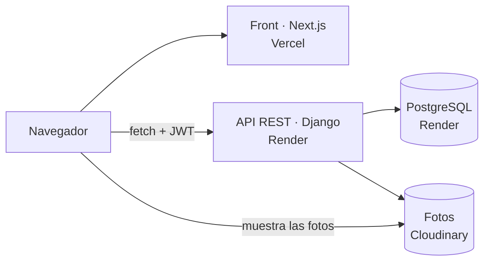
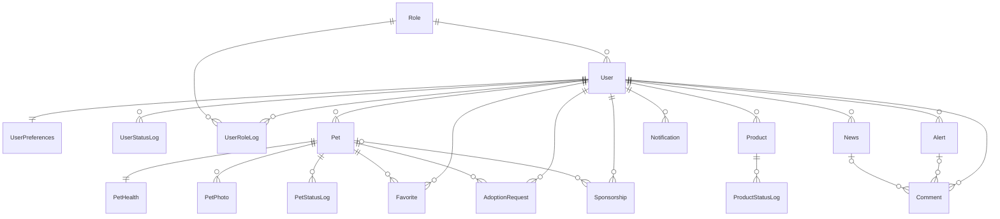

# Callejeros Río Cuarto

[](https://github.com/fbressan-itec/callejeros_app/actions/workflows/backend.yml)
[](https://github.com/fbressan-itec/callejeros_app/actions/workflows/frontend.yml)
[](https://github.com/fbressan-itec/callejeros_app/releases)

Plataforma web comunitaria de **adopción responsable** y **alertas de animales en la calle** para Río Cuarto (Córdoba, Argentina). Reúne en un solo lugar a refugios, particulares y vecinos: catálogo de mascotas en adopción, Alerta Callejeros, apadrinamiento, tienda solidaria y noticias.

Proyecto integrador de la **Práctica Profesionalizante II**, Tecnicatura Superior en Desarrollo de Software, ITEC, 2026.

| Recurso | Dirección |
| :--- | :--- |
| 🌐 **App publicada** | <https://callejeros-app.vercel.app> |
| 📘 **API y Swagger** | <https://callejeros-api.onrender.com/api/docs/> |
| 📚 **Wiki** (historia, bitácora y capturas) | <https://github.com/fbressan-itec/callejeros_app/wiki> |
| 🎨 **Maquetado** (el prototipo del que nace la app) | <https://github.com/fbressan-itec/callejeros_web> |
| 🗂️ **Tablero Kanban** | <https://github.com/users/fbressan-itec/projects/1> |

> La primera visita a la app puede tardar alrededor de un minuto: el back gratis se apaga tras 15 minutos sin uso.

## Funcionalidades

| Módulo | Qué se puede hacer | Estado |
| :--- | :--- | :--- |
| 👤 Cuentas | Registro, ingreso, recuperar contraseña y 4 roles: Miembro, Refugio verificado, Staff y Admin. | ✅ v0.1 |
| 🐾 Adopción | Catálogo con filtros y buscador, ficha con insignias calculadas, favoritos, publicar mascotas, cuestionario de adopción y panel de Staff. | ✅ v0.2 |
| 🚨 Alerta Callejeros | Avisos de animales perdidos o en peligro, con mapa, comentarios y notificaciones. | 🔜 v0.3 |
| 🤝 Colaborar y contenido | Apadrinamiento, tienda solidaria, noticias, Mi Cuenta y panel de Admin. | 🔜 v0.4 |

## Tecnologías

| Parte | Tecnologías |
| :--- | :--- |
| Back | Python 3.13 · Django 5.2 · Django REST Framework · SimpleJWT · drf-spectacular (Swagger) · uv · pytest · ruff |
| Base de datos | ORM de Django · SQLite (local) · PostgreSQL (producción) |
| Front | Next.js 16 · React 19 · TypeScript · Tailwind CSS 4 · react-hook-form + zod · Vitest · ESLint · Prettier |
| DevOps | Docker · GitHub Actions · Render (back y base) · Vercel (front) · Cloudinary (fotos) |

## Arquitectura



El back separa **vistas y serializers** (API), **servicios** (reglas de negocio) y **modelos** (datos). Las reglas y los permisos de cada rol se controlan siempre en el back. Detalle en [docs/arquitectura.md](docs/arquitectura.md).

```
backend/     API REST (Django + DRF): apps core, users, pets y adoptions
frontend/    Aplicación web (Next.js)
docs/        Documentación técnica
```

## Inicio rápido

**Requisitos:** [Docker Desktop](https://www.docker.com/products/docker-desktop/), o sin Docker [uv](https://docs.astral.sh/uv/getting-started/installation/) (instala Python 3.13 solo) y [Node.js](https://nodejs.org/) 22 o más nuevo.

```bash
git clone https://github.com/fbressan-itec/callejeros_app.git
cd callejeros_app
cp .env.example .env                  # en PowerShell: Copy-Item .env.example .env
docker compose run --rm backend uv run python manage.py migrate   # crea las tablas
docker compose run --rm backend uv run python manage.py seed      # carga los datos de prueba
docker compose up --build --watch     # back en http://localhost:8000 y front en http://localhost:3000
```

**Cuentas de prueba:** `miembro@`, `refugio@`, `staff@` y `admin@callejeros.ar`, con la contraseña de `SEED_USER_PASSWORD` del `.env`. El código de verificación maquetado (SMS y recuperar contraseña) es `8596`.

Sin Docker, la clave secreta, el panel de Django y todos los comandos: [docs/desarrollo.md](docs/desarrollo.md).

## Tests y linters

| | Back (desde `backend/`) | Front (desde `frontend/`) |
| :--- | :--- | :--- |
| Linter | `uv run ruff check .` | `npm run lint` |
| Formato | `uv run ruff format .` | `npm run format` |
| Tipos | | `npm run typecheck` |
| Tests | `uv run pytest` | `npm test` |

Los mismos controles corren solos en cada PR con GitHub Actions.

## Variables de entorno

Se leen del `.env` de la raíz (copia de [`.env.example`](.env.example)). Nunca se suben al repo.

| Variable | Ejemplo / por defecto | Para qué sirve |
| :--- | :--- | :--- |
| `DJANGO_SECRET_KEY` | *(clave aleatoria larga)* | Firma sesiones y tokens JWT del backend. |
| `DJANGO_DEBUG` | `True` | Activa el modo de desarrollo (y habilita el comando `python manage.py seed`). |
| `DJANGO_ALLOWED_HOSTS` | `localhost,127.0.0.1` | Hosts autorizados para responder desde Django. |
| `CORS_ALLOWED_ORIGINS` | `http://localhost:3000` | Orígenes que pueden consumir la API desde el navegador. |
| `DJANGO_SECURE_HTTPS` | `False` | Solo en producción: `True` activa las protecciones de HTTPS (redirección, cookies seguras y HSTS). |
| `CSRF_TRUSTED_ORIGINS` | *(vacía)* | Opcional: orígenes extra en los que confía el admin para sus formularios. |
| `DJANGO_SEED_ON_START` | `False` | Solo en producción: `True` corre el `seed` cada vez que arranca el back publicado. |
| `DATABASE_URL` | *(sin definir: SQLite)* | Base de datos. En producción, la dirección de PostgreSQL que da Render. |
| `CLOUDINARY_URL` | *(vacía: fotos en `backend/media/`)* | Solo en producción: guarda las fotos subidas en [Cloudinary](https://cloudinary.com). Es la *API environment variable* de su panel (`cloudinary://...`). Los tests nunca suben fotos, aunque esté definida. |
| `RENDER_EXTERNAL_HOSTNAME` | *(la define Render)* | Dirección del servicio en Render; se suma sola a `DJANGO_ALLOWED_HOSTS`. |
| `SEED_USER_PASSWORD` | `cambiame-clave-seed-123` | Contraseña de los usuarios de prueba que carga `python manage.py seed` (mínimo 6 caracteres). |
| `JWT_ACCESS_LIFETIME_MINUTES` | `60` | Duración en minutos del token de acceso (`access`). |
| `JWT_REFRESH_LIFETIME_DAYS` | `1` | Duración en días del token de refresco sin `"Recordarme"`. |
| `JWT_REMEMBER_ME_REFRESH_LIFETIME_DAYS` | `30` | Duración en días del token de refresco con `"Recordarme"`. |
| `MOCK_VERIFICATION_CODE` | `8596` | Código único de 4 dígitos para la verificación de teléfono y el recupero de contraseña maquetados. |
| `NEXT_PUBLIC_API_URL` | `http://localhost:8000/api` | URL base de la API que consume el cliente del frontend. |

## API

Documentación interactiva con Swagger: <https://callejeros-api.onrender.com/api/docs/> (publicada) o <http://localhost:8000/api/docs/> (local). Permisos, parámetros y reglas de cada endpoint: [docs/api.md](docs/api.md).

| Método y ruta | Quién | Qué hace |
| :--- | :--- | :--- |
| `POST /api/auth/register/` | Público | Crea una cuenta de Miembro y devuelve los tokens. |
| `POST /api/auth/login/` | Público | Inicia sesión (con "Recordarme", el refresco dura 30 días). |
| `POST /api/auth/refresh/` | Público | Renueva el token de acceso. |
| `POST /api/auth/logout/` | Público | Invalida el token de refresco. |
| `GET /api/auth/me/` | Con sesión | Datos y rol del usuario. |
| `GET /api/admin/roles/` | Admin | Lista los 4 roles. |
| `GET /api/admin/users/` · `GET /api/admin/users/{id}/` | Admin | Usuarios, con filtros y búsqueda. |
| `POST /api/admin/users/{id}/role/` | Admin | Cambia el rol y lo registra en el historial. |
| `POST /api/admin/users/{id}/deactivate/` · `.../reactivate/` | Admin | Desactiva o reactiva una cuenta (baja lógica). |
| `GET /api/pets/` | Público | Catálogo con filtros, búsqueda e insignias calculadas. |
| `POST /api/pets/` | Con sesión | Publica una mascota con fotos (queda en revisión). |
| `GET /api/pets/{id}/` | Público | Ficha de la mascota. |
| `PATCH /api/pets/{id}/` · `DELETE /api/pets/{id}/` | Autor, Staff o Admin | Edita o da de baja una mascota. |
| `POST /api/pets/{id}/adopt/` | Autor, Staff o Admin | Marca una mascota como adoptada. |
| `POST /api/pets/{id}/photos/` · `DELETE .../photos/{photo_id}/` | Autor, Staff o Admin | Suma o quita fotos del carrusel. |
| `GET /api/pets/mine/` | Con sesión | Mis publicaciones, en todos los estados. |
| `GET /api/pets/favorites/` | Con sesión | Mis favoritos. |
| `POST /api/pets/{id}/favorite/` · `DELETE` | Con sesión | Marca o desmarca un favorito. |
| `GET /api/pets/review-queue/` | Staff o Admin | Publicaciones en revisión, primero las urgentes. |
| `POST /api/pets/{id}/approve/` · `.../reject/` | Staff o Admin | Aprueba o rechaza una publicación. |
| `POST /api/pets/{id}/urgency/` | Staff o Admin | Valida o quita el caso urgente. |
| `POST /api/adoption-requests/` | Con sesión | Envía el cuestionario de adopción. |
| `GET /api/adoption-requests/mine/` | Con sesión | Mis solicitudes. |
| `GET /api/adoption-requests/{id}/` | Solicitante, Staff o Admin | Detalle y respuesta de una solicitud. |
| `GET /api/adoption-requests/review-queue/` | Staff o Admin | Solicitudes pendientes, de la más vieja a la más nueva. |
| `POST /api/adoption-requests/{id}/approve/` · `.../reject/` | Staff o Admin | Aprueba (comparte el contacto) o desaprueba con motivo. |

## Base de datos

Todas las tablas de negocio heredan un modelo base con fechas y **baja lógica** (nunca se borran filas). Vista general de las tablas y sus relaciones; los campos, las reglas y los índices de cada módulo están en [docs/base-de-datos.md](docs/base-de-datos.md).



## Publicación en línea

| Parte | Dirección | Servicio |
| :--- | :--- | :--- |
| Front | <https://callejeros-app.vercel.app> | Vercel |
| API y Swagger | <https://callejeros-api.onrender.com/api/docs/> | Render |
| Admin de Django | <https://callejeros-api.onrender.com/admin/> | Render |

**Cuentas de la demo** (todas con la contraseña `seed_password_test_123`):

| Rol | Correo | Qué permite probar |
| :--- | :--- | :--- |
| Miembro | `miembro@callejeros.ar` | Favoritos, publicar mascotas y el cuestionario de adopción. |
| Refugio verificado | `refugio@callejeros.ar` | Lo mismo que Miembro, con la insignia de refugio y su dirección pública. |
| Staff | `staff@callejeros.ar` | El panel de Staff: revisar publicaciones y solicitudes. |
| Admin | `admin@callejeros.ar` | Lo mismo que Staff, más el panel de Django. |

> Son datos de prueba: cada vez que el back arranca, se restauran las cuentas y los datos de la demo.

Se publica la rama `main`: cada versión nueva se despliega sola. Configuración paso a paso: [docs/deploy.md](docs/deploy.md).

## Documentación

| Documento | Qué tiene |
| :--- | :--- |
| [docs/desarrollo.md](docs/desarrollo.md) | Instalación con y sin Docker, datos de prueba, panel de Django, cliente de la API y tests. |
| [docs/arquitectura.md](docs/arquitectura.md) | Capas del back, organización del front y del maquetado a la app. |
| [docs/api.md](docs/api.md) | Cada endpoint con sus permisos y reglas. |
| [docs/base-de-datos.md](docs/base-de-datos.md) | Diagramas por módulo, convenciones e índices. |
| [docs/deploy.md](docs/deploy.md) | Render, Vercel y Cloudinary. |
| [CONTRIBUTING.md](CONTRIBUTING.md) | Ramas, commits, PR y reglas del código. |
| [Wiki](https://github.com/fbressan-itec/callejeros_app/wiki) | Qué es el proyecto, cómo trabajamos, bitácora con capturas y cierre. |

## Versiones

Cada versión es un hito del tablero: al cerrarlo, `develop` pasa a `main` por PR, con etiqueta y [Release](https://github.com/fbressan-itec/callejeros_app/releases).

| Versión | Estado | Qué trae |
| :--- | :--- | :--- |
| [v0.1](https://github.com/fbressan-itec/callejeros_app/releases/tag/v0.1) | ✅ Publicada | Proyecto base, base de datos, cuentas con 4 roles, layout, ingreso, registro y recuperar contraseña. |
| [v0.2](https://github.com/fbressan-itec/callejeros_app/releases/tag/v0.2) | ✅ Publicada | Adopción completa y panel de Staff. Adelantos: administración de usuarios, fotos reales en el `seed` y publicación en Render y Vercel. |
| v0.3 | Pendiente | Alertas, mapa, comentarios y notificaciones. |
| v0.4 | Pendiente | Apadrinamiento, tienda, noticias, Mi Cuenta y panel de Admin. |
| v1.0 | Pendiente | Cierre: revisión de accesibilidad, Swagger, tests y documentación. |

## Flujo de trabajo

- **Tablero Kanban** con una tarjeta por tarea, con historia de usuario y criterios de aceptación.
- **GitFlow simplificado:** `main` (versiones) · `develop` (integración) · `feature/…` y `bugfix/…` (una rama por tarjeta).
- **Conventional Commits** y **Pull Requests** con revisión, plantilla y cuatro controles automáticos (commits, nombre de rama, back y front). Merge siempre con *merge commit*.

Detalle en [CONTRIBUTING.md](CONTRIBUTING.md).

## Equipo

| Integrante | GitHub |
| :--- | :--- |
| Franco Nicolás Bressan Nadal | [@fbressan-itec](https://github.com/fbressan-itec) |
| Ulises Cabrera | [@Ulicrack](https://github.com/Ulicrack) |
| Leandro Odetto | [@leandroitec](https://github.com/leandroitec) |
