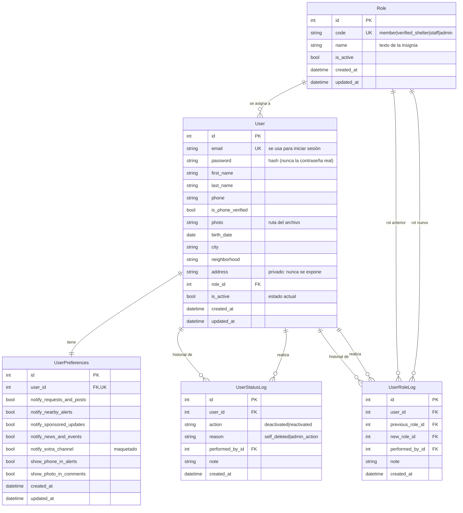

# Callejeros Río Cuarto

Plataforma web comunitaria de **adopción responsable** y **alertas de animales en la calle** para Río Cuarto (Córdoba, Argentina). Conecta a refugios, particulares y vecinos: catálogo de mascotas en adopción, Alerta Callejeros para animales perdidos o en peligro, apadrinamiento, tienda solidaria y noticias.

Proyecto integrador de la **Práctica Profesionalizante II** — Tecnicatura Superior en Desarrollo de Software, ITEC, 2026.

> 🚧 **En desarrollo.** Este README se completa a medida que avanza el proyecto (arquitectura, base de datos, instalación, variables de entorno, tests y API).

## Equipo

| Integrante | GitHub |
| :--- | :--- |
| Franco Nicolás Bressan Nadal | [@fbressan-itec](https://github.com/fbressan-itec) |
| Ulises Cabrera | — |
| Leandro Odetto | — |

## Tecnologías

| Parte | Tecnologías |
| :--- | :--- |
| Backend | Python · Django · Django REST Framework · uv · pytest · ruff |
| Base de datos | ORM de Django · SQLite |
| Frontend | Next.js · TypeScript · Tailwind CSS · Vitest · ESLint |
| DevOps | Docker · GitHub Actions |
| Organización | GitHub Projects (Kanban) |

## Estructura

```
backend/    API REST (Django + DRF)
frontend/   Aplicación web (Next.js)
docs/       Documentación y bitácora del equipo
```

## Base de datos

Diseño del modelo de datos (ORM de Django + SQLite). Se completa por partes: cuentas, adopción y colaborar, comunidad. Cualquier cambio posterior se hace con una **migración nueva** y se actualiza este diagrama en el mismo PR.

### Convenciones

- **Modelo base (`BaseModel`):** todas las tablas de negocio lo heredan y suman `created_at` (fecha de creación), `updated_at` (última modificación) e `is_active` (baja lógica).
- **Baja lógica:** nunca se borran filas de negocio; se marca `is_active = False`. Las consultas normales traen solo los activos (`Model.objects.active()`).
- **Tablas de historial** (`*Log`): registran quién hizo un cambio y cuándo. No se editan ni se dan de baja, por eso solo llevan `created_at`.
- **Quién hizo algo** se guarda con una clave foránea al usuario (`performed_by_id`), nunca copiando su nombre.
- **Valores fijos** (estados, acciones): `TextChoices` de Django; el valor guardado en inglés y el texto visible en español.
- **Nombres** de tablas y campos en inglés, en `snake_case`.
- **Imágenes:** el archivo va a `media/` (o al almacenamiento externo en deploy); la base guarda solo la ruta.
- **Índices:** las claves primarias, las foráneas y los campos únicos ya tienen índice automático.

### Cuentas y roles



| Tabla | Para qué |
| :--- | :--- |
| `Role` | Catálogo de roles. `code` es el que usa el back para los permisos; `name` es el texto de la insignia. Un usuario tiene un solo rol; al registrarse, `member`. |
| `User` | Usuario propio (reemplaza al de Django desde la primera migración). Inicia sesión con `email`; no tiene `username`. |
| `UserPreferences` | Preferencias de notificación y de privacidad (uno a uno con `User`). Se crea al registrarse, todas en sí salvo `notify_extra_channel`. |
| `UserStatusLog` | Historial de bajas y reactivaciones: si el usuario se dio de baja solo (A3) o lo hizo un Admin (A4), y quién. |
| `UserRoleLog` | Historial de cambios de rol: rol anterior, rol nuevo y qué Admin lo cambió. |

**Reglas de cuentas:**
- **Contraseña:** mínimo **6 caracteres**. Si no se cumple, el mensaje de error lo dice explícitamente: "La contraseña debe tener al menos 6 caracteres". Se valida en el back y en el front.
- `is_active` de `User` es el estado actual (Django no deja iniciar sesión a un usuario inactivo); la historia completa queda en `UserStatusLog`.
- Solo el Admin cambia roles; cada cambio deja una fila en `UserRoleLog`.

## Flujo de trabajo

- **Tablero Kanban:** [Callejeros — Tablero](https://github.com/users/fbressan-itec/projects/1). Cada tarea es una tarjeta con historia de usuario y criterios de aceptación.
- **Ramas (GitFlow simplificado):**
  - `main`: versiones entregables (v0.1, v0.2…);
  - `develop`: integración;
  - `feature/<n°>-<nombre>` y `bugfix/<n°>-<nombre>`: una por tarjeta, desde `develop`;
  - `hotfix/<nombre>`: errores urgentes en `main`.
- **Commits:** [Conventional Commits](https://www.conventionalcommits.org/es/v1.0.0/) (`feat(auth): agrega endpoint de login`). Se revisan automáticamente en cada PR.
- **Pull Requests:** todo entra a `develop` por PR, con revisión de código y *merge commit* (cada commit queda visible en el historial). `main` y `develop` están protegidas: no se puede subir directo.
- **Bitácora:** cada integrante registra su avance en [`docs/bitacora/`](docs/bitacora/LEEME.md).
