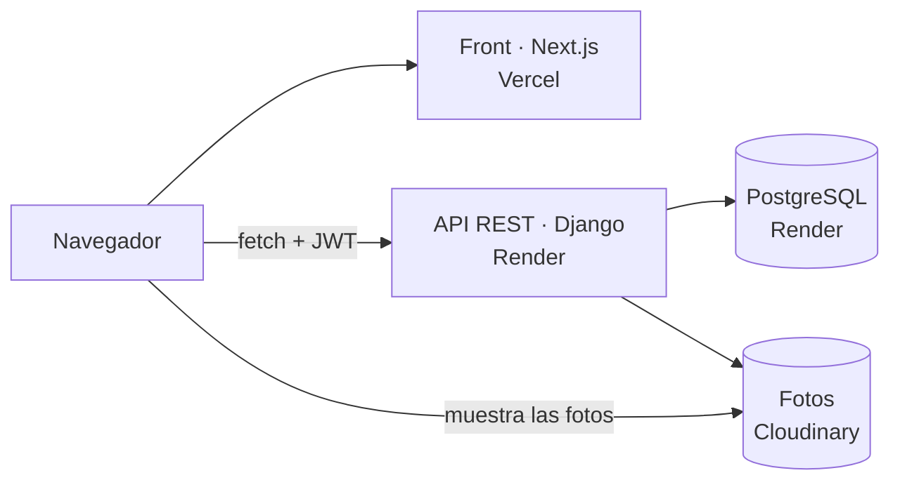

# Arquitectura

> Volver al [README](../README.md).

Callejeros tiene dos partes que se hablan por una **API REST**: el **back** (Django) guarda los datos y aplica las reglas, y el **front** (Next.js) es lo que ve la persona en el navegador.

## En producción



En local es lo mismo, con el back en `localhost:8000`, el front en `localhost:3000`, SQLite en lugar de PostgreSQL y las fotos en `backend/media/`. Cómo se publica cada parte: [deploy.md](deploy.md).

## Capas del back

```
Pedido HTTP ──► Vista y serializer (DRF) ──► Servicio ──► Modelo (ORM) ──► Base de datos
                 recibe, valida y responde    reglas de    datos y baja
                 controla el permiso del rol  negocio      lógica
```

| Capa | Dónde | Qué hace |
| :--- | :--- | :--- |
| Vistas y serializers | `apps/<app>/views.py`, `serializers.py` | Reciben el pedido, validan los datos de entrada, controlan el permiso del rol y arman la respuesta. Exponen solo los campos necesarios. |
| Servicios | `apps/<app>/services.py` | Las reglas de negocio (publicar, aprobar, adoptar, dar de baja…). Las vistas y el admin de Django los usan por igual. |
| Modelos | `apps/<app>/models.py` | Los datos. Todas las tablas de negocio heredan `BaseModel` (fechas y baja lógica). Detalle en [base-de-datos.md](base-de-datos.md). |
| Comunes | `apps/core/` | Lo compartido: modelo base, paginación, validadores, flujo de revisión (`ReviewWorkflow`) y el comando `seed`. |

Apps del back: `core`, `users` (cuentas, roles y autenticación), `pets` (mascotas, fotos, insignias y favoritos) y `adoptions` (solicitudes de adopción).

## Reglas de diseño

- **Las reglas de negocio y los permisos se controlan en el back**, en cada endpoint. Ocultar un botón en el front no alcanza.
- **Validación en dos capas:** en el front (`zod` + `react-hook-form`) para avisar rápido, y en el back (serializers y modelos) para que nada inválido llegue a la base.
- **Baja lógica:** nada de negocio se borra; se marca `is_active = False`.
- **Autenticación con JWT** (`SimpleJWT`): token de acceso de 60 minutos y de refresco de 1 día (30 con "Recordarme"). Cerrar sesión invalida el de refresco.
- **Configuración solo por variables de entorno** (`django-environ`), sin secretos en el código.

## El front

| Parte | Dónde | Qué hace |
| :--- | :--- | :--- |
| Páginas | `frontend/src/app/` | Una carpeta por dirección (App Router de Next.js 16). |
| Componentes | `frontend/src/components/` | Agrupados por módulo (`pets`, `staff`, `layout`…). |
| Cliente de la API | `frontend/src/lib/api/client.ts` | Todas las llamadas al back pasan por acá: arma la dirección con `NEXT_PUBLIC_API_URL` y traduce los errores (`ApiError`, con los errores de cada campo). |
| Sesión | `frontend/src/lib/auth/session.ts` | Guarda la sesión con los tokens JWT ("Recordarme" decide si dura al cerrar el navegador). |
| Estilos | `frontend/src/app/globals.css` | Tailwind 4 con los colores, sombras y fuentes del maquetado; modo claro y oscuro con `next-themes`. |

## Del maquetado a la app

| | [Maquetado](https://github.com/fbressan-itec/callejeros_web) | Esta app |
| :--- | :--- | :--- |
| Pantallas | HTML, una página por sección | Next.js + React |
| Estilos | Tailwind CSS 3 | Tailwind CSS 4, con el mismo diseño |
| Lógica | JavaScript en el navegador | Reglas de negocio en el back (Django) |
| Datos | Guardados en el navegador (LocalStorage) | Base de datos (SQLite en local, PostgreSQL publicada) |
| Sesión y roles | Simulados con botones de prueba | Ingreso con JWT y permisos por rol en cada endpoint |
